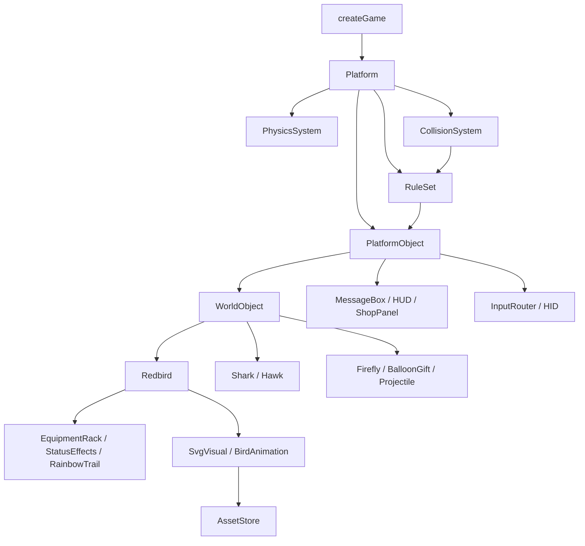

# Platform และวัตถุใน Nightly Bird

โค้ดใช้ JavaScript ESM (`.js`, `import` / `export`) ไม่มี runtime dependency
จุดประกอบเกมคือ `src/game/create-game.js` ส่วน `src/main.js` รับผิดชอบหน้าโหลด การลองใหม่ และเริ่มวงรอบเกม

## ความสัมพันธ์



`Platform` ดูแลทะเบียนวัตถุ โหลดทรัพยากร วงรอบเกม เวลา คิวคำสั่งและเหตุการณ์
การเคลื่อนที่ การยึดติดกัน และการตรวจชน ส่วนกติกาเฉพาะเกมอยู่ใน `rules/`
ไม่มีตัวแปร `bird`, `enemies`, `items` หรือ `session` แบบ singleton ในระดับโมดูล
สร้าง Platform สองชุดแล้วสถานะไม่ปนกันได้

เกมที่ประกอบไว้เป็นเกมผู้เล่นคนเดียว กฎร้านค้า/HUD เลือกผู้เล่นหลักจาก tag `player`
คลาสนกและศัตรูมีสถานะแยกต่อ instance; ศัตรูเลือกผู้เล่นผ่าน `targetId`
การเพิ่มโหมดหลายผู้เล่นจะต้องขยายกฎรอบเกม ร้านค้า และ HUD เพิ่มเติม

## เจ้าของข้อมูลและพฤติกรรม

| คลาส                                | หน้าที่                                                                  |
| ----------------------------------- | ------------------------------------------------------------------------ |
| Platform                            | รับวัตถุเข้า/ออก กำหนดจุดอัปเดต ประสานระบบ และคืนทรัพยากร                |
| PhysicsSystem                       | เขียนตำแหน่งโลก เคลื่อนตามความเร็ว จำกัดขอบเขต และแก้ attachment         |
| CollisionSystem                     | ตรวจ circle/polyline, กลุ่มที่ชนกันได้, enter/stay/exit และ swept circle |
| GameSession                         | phase ระยะทาง ความเร็วฉาก หนอน ความคืบหน้า และข้อมูลจบรอบ                |
| Redbird                             | ชีวิต AGI การบิน กระพือ ร่อน กระพริบตา เคี้ยว พ่นสายรุ้ง ตาย และฟื้น     |
| Shark                               | ลาดตระเวน ไล่ ล็อกตำแหน่ง พุ่งจากน้ำ กระโดด พัก และคาบนก                 |
| Hawk                                | ลาดตระเวน ล็อกตำแหน่ง พุ่งตรง ถอนตัว และชะงัก                            |
| Firefly                             | การบินและภาพของตัวเอง การถูกเก็บ และชนิดปกติ/สายรุ้ง                     |
| BalloonGift                         | ลูกโป่ง กล่อง การแกว่ง collider สองส่วน และการแตกครั้งเดียว              |
| StormCloud / LightningBolt          | ล็อกตำแหน่ง ชาร์จ สร้างรูปสายฟ้าเดียวกันสำหรับภาพและการชน                |
| Projectile                          | ติดตามตัวตนและรุ่นการเกิดของเป้าหมาย เคลื่อนที่ กระทบ และหมดอายุ         |
| SharkCorpse                         | ซากปลาแต่ละตัว มีตำแหน่งและอายุของตัวเอง                                 |
| NightSky / WaterSurface / WindField | ฉาก น้ำ และแรงลมตามตำแหน่ง                                               |
| EquipmentRack                       | เป็นเจ้าของ Helmet, LightningSuit และ Gun; ป้องกันการใช้ซ้ำ              |
| StatusEffects                       | เวลา boost, magnet, predatorProtection และ lightningProtection           |
| RainbowTrail                        | จุดสายรุ้งของ Redbird แต่ละตัว อัปเดตครั้งเดียวผ่านเจ้าของ               |
| ParticleEmitter                     | อนุภาคกระเด็น ฟอง คลื่น ข้อความ แฟลช และแรงสั่นของฉาก                    |
| SvgVisual / BirdAnimation           | ตัววาดและแอนิเมชันต่อ instance; ปีก ตา และปากทำงานพร้อมกันได้            |
| AssetStore                          | โหลด/decode SVG และ cache ภาพร่วมกันภายใน Platform                       |
| InputRouter / HIDTap / HIDKeyboard  | รวม input หลายอุปกรณ์เป็นคำสั่งเดียว และจัดการการกดค้าง                  |
| MessageBox / HUD / ShopPanel        | อ่านสถานะ แสดง DOM และส่งคำสั่ง; ไม่แก้ข้อมูลเกมโดยตรง                   |
| ScoreStore                          | อ่านและบันทึกสถิติผ่าน storage ที่ฉีดเข้ามาได้                           |

วัตถุที่มีเจ้าของอยู่แล้ว เช่นอุปกรณ์และแอนิเมชัน ไม่ลงทะเบียนเป็นวัตถุรากซ้ำ
เพื่อลดความเสี่ยงที่ timer หรือ animation จะอัปเดตสองครั้ง
อนุภาคตกแต่งเก็บเป็นชุดข้อมูลใน emitter; การเปลี่ยนพิกัดยังผ่าน PhysicsSystem

## กฎ

| Rule            | สิ่งที่ตัดสิน                                                 |
| --------------- | ------------------------------------------------------------- |
| RunRule         | เริ่มรอบ ตาย รอร่างพ้นจอ ชุบชีวิต หยุดพัก และจบรอบ            |
| WaterRule       | ข้ามผิวน้ำ กระเด้งสามครั้ง เติมจำนวนกระเด้ง และจมน้ำ          |
| CombatRule      | เขตที่โจมตีได้ การป้องกัน/คุ้มกัน ผลการชน และการตาย           |
| PickupRule      | เพิ่ม AGI บูสต์ สุ่มรางวัล และแปลงของซ้ำเป็นหนอน              |
| WeaponRule      | ยิงเมื่อผู้ล่าเริ่มโจมตี ผลกระสุน และให้ศัตรูหายไปชั่วคราว    |
| ProgressionRule | ปลดล็อกปลา เหยี่ยว และเมฆตามระยะทาง                           |
| SpawnRule       | เวลาเกิดหิ่งห้อย ของขวัญ เมฆ ชุดกันฟ้าก่อนด่าน และศัตรูกลับมา |
| ShopRule        | ราคา จำนวนหนอน ของซ้ำ และระยะรอก่อนรับคำสั่งจากร้าน           |

กฎเรียกความสามารถของวัตถุ เช่น `bird.die()`, `hawk.attack()`, `gun.shoot()`
ส่วนการบินและแอนิเมชันยังเป็นความรับผิดชอบของวัตถุ ไม่ย้ายทั้งหมดไปไว้ใน Rule
`RuleSet` เป็นวัตถุที่ Platform รับเข้าไป และเรียกแต่ละ Rule ตามลำดับที่ประกอบไว้

## ลำดับหนึ่งเฟรม

1. รับวัตถุที่โหลดพร้อมแล้ว และทำรายการลบที่รออยู่
2. เพิ่มเวลา UI, poll อุปกรณ์ และรับคำสั่ง เช่น flap/release, revive, buy, pause
3. ถ้า simulation ไม่หยุด: เก็บตำแหน่งก่อนหน้า อัปเดตกฎ/timer และให้วัตถุวางแผนความเร็ว
4. ส่งเหตุการณ์ก่อน physics เช่น `attack-started` → `shot-requested` และรับกระสุนที่พร้อมเข้าเฟรมนี้
5. PhysicsSystem เคลื่อนวัตถุทั้งหมด แล้วคำนวณวัตถุที่ยึดติดกัน
6. ตอบสนองการข้ามผิวน้ำ/ขอบเขต จากนั้นตรวจชนและตัดสินผล
7. อัปเดตอายุเอฟเฟกต์ สถานะจบรอบ และแอนิเมชัน แล้วทำรายการเพิ่ม/ลบ
8. Renderer วาดตาม layer และให้ UI อ่านสถานะล่าสุด

การชนมีลำดับตัดสินที่กำหนดไว้: ผิวน้ำ → ปลา → เหยี่ยว → หิ่งห้อย → สายฟ้า → ของขวัญ → กระสุน
contact ที่มีระดับเดียวกันเรียงตาม object id และชื่อ collider อย่างคงที่
ผลที่เปลี่ยนการรับ contact ถัดไป เช่นตาย ใช้หมวก หรือเก็บของแล้ว มีผลทันที
การลบจริงรอจุดที่ปลอดภัย วัตถุที่มี `removing` ไม่รับผลซ้ำ

ยังใช้ delta ตามเวลาจริงและจำกัดสูงสุด 0.033 วินาทีเหมือนเดิม ไม่ได้เปลี่ยนเป็น fixed timestep
การวาดไม่เปลี่ยนสถานะ simulation; cache ภาพ tint และ cache DOM เป็นข้อมูลแสดงผลเท่านั้น
`random` และ `cosmeticRandom` แยก stream และฉีดจากภายนอกได้สำหรับการทดสอบ

## การเคลื่อนที่และพิกัด

- พิกัดโลกใช้ CSS pixels; pixel ratio มีผลเฉพาะ Canvas backing store
- `WorldObject.x/y` เป็น getter อ่านจาก transform วัตถุวางแผนผ่าน `body.vx/vy/ax/ay`
- `dynamic` รับความเร่ง, `kinematic` เคลื่อนตามความเร็วที่กำหนด, `static` ไม่เคลื่อน
- `attached` ติดตาม anchor ของ parent และไม่ถูก integrate เป็นอิสระในเฟรมเดียวกัน
- การเกิดใหม่ ย้ายตำแหน่ง หรือปรับขอบเขตอย่างชัดเจนใช้ `platform.physics.place()` / `clamp()`
- จุดหมุนปีกและปากใน SVG เป็นพิกัดภาพภายใน ไม่ใช่ตำแหน่งในโลก
- กลุ่ม collider แยกจาก layer วาด; นกมี body และ beak, ของขวัญมี balloon และ box
- กระสุนและผู้ล่าใช้ swept circle เพื่อไม่พลาดวัตถุระหว่างเฟรม
- สายฟ้าตรวจชนเฉพาะเฟรมเริ่มผ่า แต่ภาพอยู่ต่อ 0.28 วินาที
- การ resize คำนวณขนาดนกและเขตใหม่; ไม่ทำให้ตำแหน่งพิกัดกลายเป็นหน่วย device pixels

## หิ่งห้อยขณะเคี้ยว

เมื่อเก็บสำเร็จ `PickupRule` เรียก `Redbird.eat(firefly)` เพื่อเริ่มท่าเคี้ยวและให้
Firefly อยู่ในสถานะ eaten โดยยังคงวัตถุไว้ในฉากจนเคี้ยวเสร็จ
PhysicsSystem ยึดตัวหิ่งห้อยกับ `Redbird.mouthAnchor()` ซึ่งอิงตำแหน่งปากในภาพ SVG
มุมเอียงของนก และท่าเคี้ยวปัจจุบัน ไม่มีการบินหรือการชนเพื่อรับรางวัลซ้ำ

นกเป็นเจ้าของรายการ `mouthfuls` หิ่งห้อยถูกวาดระหว่างตัวนกและชั้นปากด้านหน้า
เพื่อให้เห็นว่าถูกคาบอยู่ แสงของตัวที่ถูกคาบลดลงและไม่มีเส้นทางบินเก่าตามมา
Platform อัปเดต attachment อีกครั้งหลัง animation เพื่อให้ตรงกับท่าที่วาดในเฟรมเดียวกัน

หิ่งห้อยหายเมื่อ `BirdAnimation.chewTime` หมด หากกินหลายตัวติดกันจะค้างอยู่จนจบรอบเคี้ยวล่าสุด
การหยุดพักหยุดทั้งท่าเคี้ยวและเวลาที่ค้างอยู่ การตาย เริ่มรอบใหม่ หรือลบนกจะล้างวัตถุในปาก
รางวัลและเหตุการณ์เสียงยังเกิดครั้งเดียวตอนเก็บสำเร็จ ใช้ทั้งหิ่งห้อยปกติและสายรุ้ง

## เสียง

`AudioSystem` เป็น PlatformObject ที่รับ `firefly-eaten` แล้วเล่น `assets/audio/crunch.wav`
PickupRule ส่งเหตุการณ์หลังเก็บหิ่งห้อยสำเร็จครั้งเดียว ใช้ทั้งหิ่งห้อยปกติและสายรุ้ง
การเคี้ยวหรือวาดภาพเพียงอย่างเดียวไม่เล่นเสียง ของขวัญไม่ส่งเหตุการณ์นี้

Web Audio โหลด/decode buffer ครั้งเดียวและสร้าง source แยกต่อเสียง จำกัดเสียงซ้อนสูงสุด 4 เสียง
เริ่ม source จากต้นไฟล์ทันทีในเฟรมที่เก็บสำเร็จ
ไฟล์ WAV ในเกมถูกตัดช่วงเบาต้นเสียง 0.635 วินาทีออก เหลือประมาณ 0.365 วินาที
ขนาดลดจาก 176,478 เป็น 64,432 ไบต์ และเสียงกัดหลักเริ่มภายในประมาณ 6.4 มิลลิวินาที
รายการไฟล์อยู่ใน `src/config/audio.js` และไม่ต้องกำหนด playback offset
ขอ AudioContext แบบ `latencyHint: 'interactive'` และ
resume AudioContext จาก pointerdown/keydown โดยตรงเพื่อรองรับนโยบาย autoplay
เสียงที่เกิดขณะยังปลดล็อกไม่ได้จะไม่ค้างรอไปดังภายหลัง โหลดเสียงล้มเหลวไม่ทำให้เริ่มเกมไม่ได้
เมื่อลบหรือ dispose ระบบจะหยุดเสียง ถอน listener และปิด context

`createGame({ audio })` รับระบบเสียงที่ฉีดเข้ามาได้ หรือใช้ `audio: null` เพื่อปิดเสียง
เมื่อสร้างเกมแบบไม่มี host จะไม่สร้าง AudioContext จึงยังทดสอบ simulation ใน Node ได้

## สถานะและเวลา

`GameSession.phase` คือ ready/play/dead/shop/paused ส่วน `Redbird.lifeState` คือ alive/dead
นกตายแล้ว simulation ยังทำงานเพื่อให้ตกน้ำหรือถูกลากลงน้ำ
ร้านค้าและ pause หยุดเวลา simulation, timer ไอเท็ม และแอนิเมชัน แต่เวลา UI เดินต่อ
จึงใช้เวลา UI ตรวจช่วง 0.4 วินาทีก่อนรับคำสั่งซื้อได้

เริ่มรอบใหม่ล้างวัตถุ scope `run`, ข้อมูลรอบ ไอเท็ม และ animation channels
ชุบชีวิตเก็บความคืบหน้าและอุปกรณ์ตามกติกาเดิม หักหนอน ปลด attachment และเพิ่มเวลาคุ้มกัน
สถิติคงอยู่ใน ScoreStore ที่ key `rbn-best`

## Lifecycle และทรัพยากร

- `add(object)` จอง id และเจ้าของเพียง Platform เดียว เรียก `load(assets)`
- `assetKeys` ของแต่ละวัตถุระบุไฟล์ที่ต้องใช้ AssetStore รวมคำขอโหลดไฟล์เดียวกัน
- `await platform.load()` รอวัตถุเริ่มต้นทั้งหมดก่อนเริ่มเล่น
- วัตถุใหม่ระหว่างเล่นจะเข้าทะเบียนที่จุด flush หลังโหลดพร้อมเท่านั้น
- โหลดไม่สำเร็จจะไม่ทำให้วัตถุเข้าฉาก; ดูข้อผิดพลาดได้จาก `platform.loadErrors`
- `remove(object)` กันการอัปเดตทันที แล้ว detach/dispose ณ จุด flush
- `remove(object, { dispose: false })` นำออกจากฉากโดยยังไม่คืนทรัพยากรถาวรของวัตถุ
- ลบ parent แล้วลูกหลุดจาก attachment; async load เก่าไม่สามารถทำให้วัตถุที่ลบไปกลับมาได้
- `platform.dispose()` หยุด loop ถอน event listeners และคืน cache รวมถึงตอนโหลดหน้าแรกไม่สำเร็จ

หน้าโหลดแสดงข้อผิดพลาดและปุ่มลองใหม่ การลองใหม่สร้าง Platform ใหม่โดยไม่เหลือ listener ซ้ำ

## ตัวอย่างการประกอบและเพิ่มวัตถุ

```js
import { createGame } from './src/game/create-game.js';
import { Hawk } from './src/objects/hawk.js';

const platform = createGame({
  canvas: document.querySelector('canvas'),
  document,
  host: window,
  width: innerWidth,
  height: innerHeight,
  pixelRatio: devicePixelRatio,
});
await platform.load();
platform.add(new Hawk({ id: 'hawk-2', targetId: 'player' }));
await platform.load();
platform.get('hawk-2').respawn();
platform.start();
```

ตัวอย่างนี้ใช้ DOM ของเกมปัจจุบันสำหรับ HUD/เมนู ดูรายการประกอบหลักทั้งหมดใน `create-game.js`
เพิ่มคลาสที่สืบทอด `PlatformObject` ได้โดยไม่ต้องมี body ถ้าต้องการการเคลื่อนที่ให้ใช้ `WorldObject`

`HIDGamepad` เป็น adapter เสริมที่ทดสอบการกด/ปล่อยและถอดอุปกรณ์แล้ว แต่ยังไม่ได้เปิดในเกมเริ่มต้น
ปัจจุบันมี mapping ปุ่ม A → flap และ Start → pause; การเลือกเมนูด้วย gamepad ยังต้องเพิ่มก่อนเปิดใช้งานเต็มรูปแบบ

## ความต่างที่ตั้งใจแก้

- จมน้ำไม่ตั้งสถานะถูกปลาคาบ
- การวาดเหยี่ยวไม่เขียนสถานะกลับเข้า simulation
- หลาย collider ของของขวัญให้รางวัลได้ครั้งเดียว
- กระสุนตรวจการเคลื่อนที่ระหว่างเฟรม และไม่ติดตามศัตรูที่ถูกแทนที่หรือเกิดใหม่
- ปล่อย input หนึ่งอุปกรณ์ไม่ล้างการกดค้างของอุปกรณ์อื่น
- กระพริบตาเป็น state ของ BirdAnimation จึงไม่ทับ method `Redbird.blink()`
- เวลา UI แยกจากเวลาเกม และมี pause ผ่าน P/Escape

สมการการบิน ระยะทาง บูสต์ จำนวนกระเด้ง ราคา และระยะปลดล็อกยังยึดกติกาเดิม
จังหวะที่วัตถุหลายชิ้นเคลื่อน/ชนกันอาจต่างจากการอัปเดตทีละชนิดเดิม โดยเฉพาะการตรวจ swept collision
จึงไม่ถือว่า simulation ใหม่เหมือนเดิมทุกเฟรมทุกเหตุการณ์

## การตรวจสอบ

`npm run check`, `npm test`, `npm run build`

Node tests ครอบคลุมกติกาเดิมและขอบเขตใหม่: instance isolation, lifecycle async, attachment,
input หลายอุปกรณ์, reward ครั้งเดียว, swept collision, target identity, pause และ shop clock

การทดสอบเบราว์เซอร์ประกอบการย้ายครั้งนี้ตรวจ SVG ทุกตัว ท่าต่าง ๆ และซากปลา การวาดไม่แก้สถานะเกม
ปุ่มชุบชีวิต/ซื้อ/เล่นต่อ จอแนวตั้ง/แนวนอน การโหลดภาพล้มเหลว/ลองใหม่ และ build ใต้ `/nightly-bird/`
เทียบการบิน ระยะทาง และบูสต์กับรุ่นก่อนหน้า 84 จุดตรวจ โดยปิดการสุ่มเกิดไอเท็มในกรณีเปรียบเทียบนั้น
